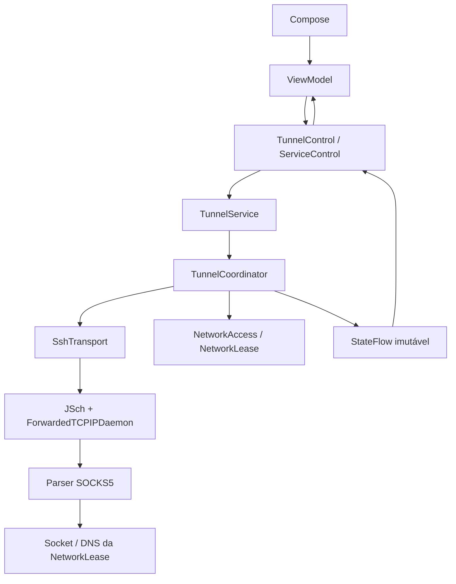

# Arquitetura

Um módulo `app`, Clean Architecture enxuta e MVVM com fluxo unidirecional. `domain` usa Kotlin puro. `application` depende de domain e Coroutines/Flow e define portas; não importa Android, Compose, JSch nem implementações. `infrastructure` adapta Android, SSH, DNS, sockets e persistência. `presentation` mostra estados, envia comandos e trata a fronteira do seletor de documentos. `service` controla ciclo de vida Android. `di` compõe os objetos.

## Dependências e escopos

`TunnelApp.Graph` tem escopo do processo: perfis, cofre, confiança do host, histórico, transporte e `ServiceControl`. O cofre AES-GCM usa Android Keystore; perfis não incluem material secreto. O histórico cifrado tem publicador de 1 s em escopo IO do processo. A morte do processo não persiste conectado.

`TunnelService` possui escopo SupervisorJob, `AndroidNetworks` e exatamente um `TunnelCoordinator`. `ServiceControl` inicia o serviço com comandos explícitos e publica os snapshots recebidos; não cria coordenador. ViewModel usa contratos da aplicação e StateFlow, coleta na tela com `collectAsStateWithLifecycle`. `ProfileActions` mantém os buffers de chave fora do estado da UI e apaga buffers temporários; validação específica do formato pertence ao adaptador de credenciais.

## Estado, concorrência e recursos

Estados: Desconectado → Conectando → Conectado; falta de rede → Aguardando rede; falha temporária → Reconectando; falhas permanentes → Erro. Um ator com Channel serializa comandos. Há um único worker da sessão, cancelado e aguardado antes de trocar perfil ou desconectar. Somente esse worker pode publicar estado conectado. Transportes antigos nunca chamam o coordenador para reiniciar sessões.

O worker usa `SshConnection.use`, fechando os recursos em cancelamento, troca de rede ou falha. `OwnedSession` registra sockets/canais e fecha inclusive recursos registrados após cancelamento. A abertura bloqueante acontece em executor IO com `suspendCancellableCoroutine`; seu cancelamento fecha o owner. Um prazo limita a negociação SSH e outro limite da biblioteca limita o pedido de forwarding. O ator confirma a conclusão da desconexão ao serviço antes de `stopSelf(startId)`, evitando destruir uma solicitação de início mais recente. O serviço cancela o escopo e remove callbacks de rede em onDestroy.

A seleção usa leases imutáveis que retêm `Network`. Wi-Fi/móvel validados são candidatos. Um erro de conexão SSH pode tirar temporariamente a rede das candidatas no modo automático, permitindo fallback. Retorno ao Wi-Fi exige 15 s de estabilidade, e rede com falha tem cooldown de 30 s. A consulta externa de IPv6 é cancelada/substituída nas mudanças e independente da sessão. Não vincula todo o processo nem permite saída pela rede padrão sem seleção.

## Evidência do SSH remoto dinâmico

Biblioteca: **mwiede/JSch 2.28.8**, acompanhada por Bouncy Castle 1.86 para algoritmos disponíveis no Android. Não há `-D`, proxy HTTP, shell ou PTY.

Foram consultados o código da versão fixada e as APIs oficiais:

- [Session.java, tag jsch-2.28.8](https://github.com/mwiede/jsch/blob/jsch-2.28.8/src/main/java/com/jcraft/jsch/Session.java): `setSocketFactory` injeta a conexão SSH; `setPortForwardingR(bind, port, daemon, args)` solicita `tcpip-forward` com `want_reply=1`; `_setPortForwardingR` aguarda até cerca de 10 s e rejeita respostas diferentes de sucesso.
- [ChannelForwardedTCPIP.java, mesma tag](https://github.com/mwiede/jsch/blob/jsch-2.28.8/src/main/java/com/jcraft/jsch/ChannelForwardedTCPIP.java): recebe `forwarded-tcpip`, instancia o daemon e passa seus fluxos/argumentos. O daemon é público, tem construtor vazio e não é ofuscado no APK debug.
- [RFC 4254 §7](https://www.rfc-editor.org/rfc/rfc4254.html#section-7) e [RFC 1928](https://www.rfc-editor.org/rfc/rfc1928.html): forwarding e processamento SOCKS5.
- [Android Network](https://developer.android.com/reference/android/net/Network): socket factory, DNS e `openConnection` por rede.
- [Recomendações de arquitetura Android](https://developer.android.com/topic/architecture/recommendations).

O daemon processa SOCKS5 diretamente nos canais, sem listener local adicional. O output direto do Channel envia dados/EOF; o pipe do daemon fica aberto até terminar o trabalho para evitar desconectar a outra direção prematuramente. O parser usa leituras exatas, deadline de handshake de 15 s, CONNECT com sucesso apenas após socket conectado, erros RFC e duas direções de cópia. Contam-se somente payloads escritos com sucesso; cada canal recebe um identificador e metadados de início/fim.

Keepalive é `keepalive@jcraft.com` no protocolo SSH com pedido de resposta. O loop de leitura JSch envia keepalive após timeout e encerra no timeout seguinte ao limite de envios. O adaptador configura `serverAliveCountMax = limiteDeAusências - 1`, para três intervalos de 30 s resultarem em aproximadamente 90 s sem respostas, evitando o intervalo extra do valor bruto 3 da biblioteca. Qualquer mensagem SSH válida reinicia esse contador; atrasos Android ainda afetam o tempo efetivo. A conexão inicial tem timeout de 15 s; DNS/conexão são vinculados à mesma rede. O prazo de negociação é iniciado após carregar credenciais, antes da conexão SSH.

## Testes e limites

Unitários substituem SSH/rede/perfis/histórico/espera e testam transições, duplicação, cancelamento e troca de rede. O protocolo é testado com streams fragmentados e sockets TCP locais reais; a integração OpenSSH verifica o mecanismo completo de forwarding no JVM. Testes instrumentados/validação visual são descritos em `docs/VALIDATION.md`.

`check_architecture.py` é executado em `check` e rejeita imports Android/Compose/SSH/adaptadores nas camadas internas. Os testes locais não comprovam a política de roteamento do aparelho, acesso móvel à EC2, comportamento com tela apagada ou igualdade de IPv6 público. Esses precisam do dispositivo/rede reais. A seleção de endereço IPv6 de origem fica sob responsabilidade do sistema; diferenças precisam ser investigadas. Recursos de domínio não dependem dos projetos loto-bot ou whatsapp-notify.

Sem restauração automática de uma sessão após morte do processo. Reboot oferece ação manual em notificação. Histórico tem limite de encerrados e eventos, mantendo registros ativos. Nome SSID/operadora não é consultado: evitam-se permissões de localização/telefone adicionais. Escuta loopback é fixa para preservar segurança. Release com minificação futura deve preservar `SocksDaemon` e seu construtor usado por reflexão.

A confirmação de primeira chave usa o comando Retry, que cancela e aguarda a tentativa inicial antes de abrir outra. Isso elimina a corrida em que a confirmação chega enquanto o worker inicial ainda está encerrando. Conectar repetido continua sendo idempotente durante uma tentativa/sessão ativa.
