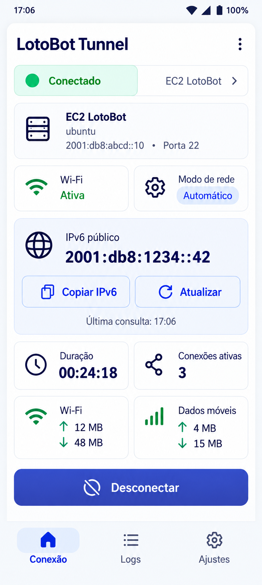
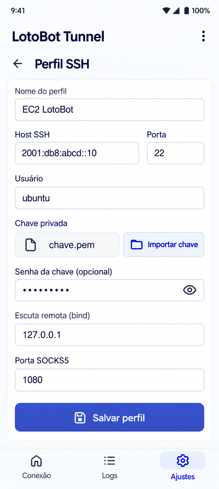
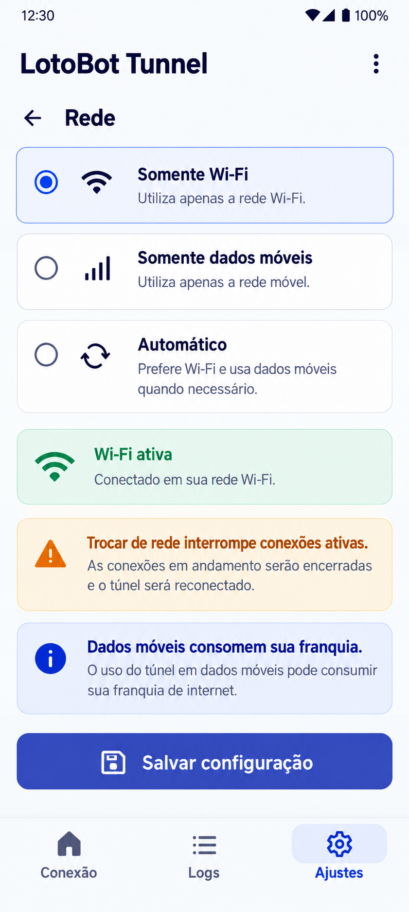
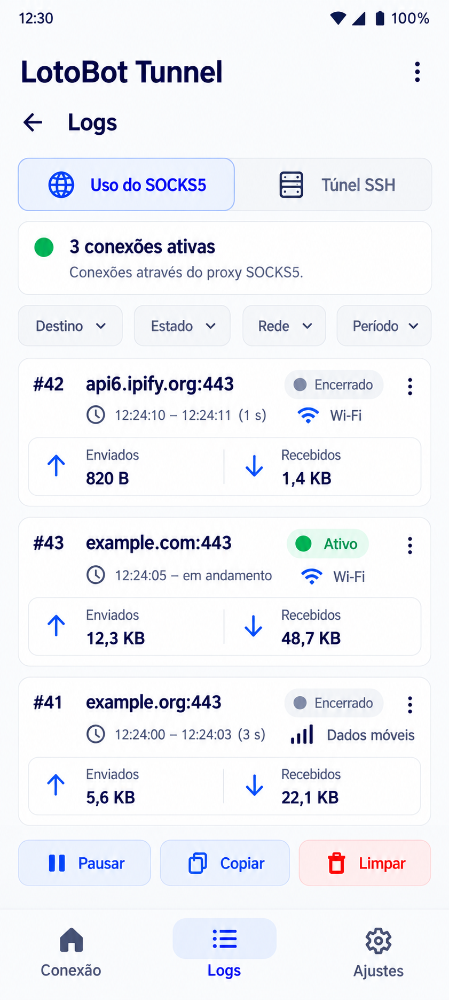
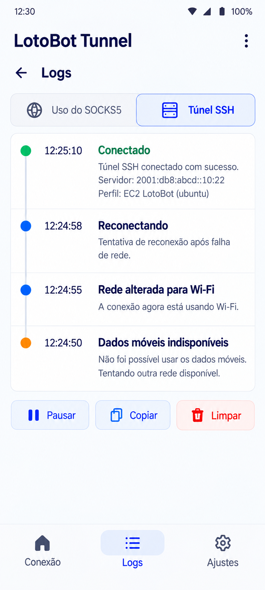
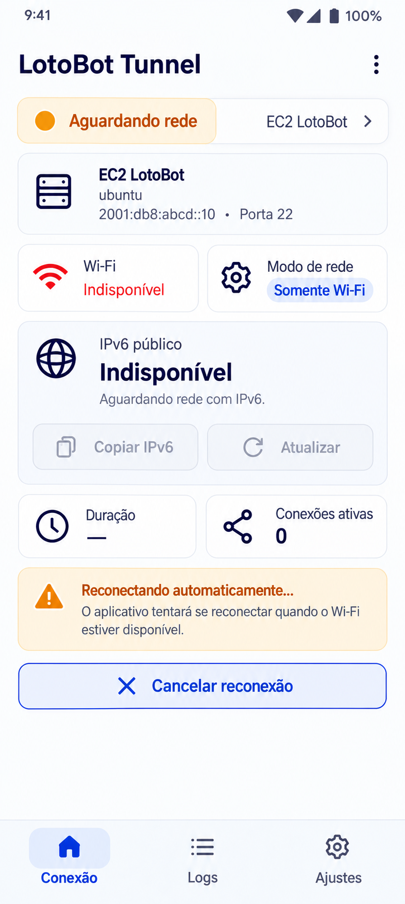

# Criar aplicativo Android: LotoBot Tunnel

Crie um aplicativo Android chamado **LotoBot Tunnel** para manter um túnel SSH com SOCKS5 reverso entre meu celular e uma instância AWS EC2, utilizando Wi-Fi ou dados móveis.

Utilize as **imagens PNG anexadas como referência visual** e as **especificações em Markdown deste prompt como referência funcional e de implementação**.

## 1. Objetivo

Meu LotoBot e o Chromium executam na EC2. Quero que as conexões realizadas pelo proxy saiam pela conexão do celular, sem precisar manter meu computador ligado.

Quando o celular utilizar o Wi-Fi residencial da Vivo, o tráfego deve sair pela internet residencial. Quando utilizar dados móveis, deve sair pela rede da operadora do chip.

O aplicativo deve:

- Manter o túnel SSH ativo em segundo plano.
- Reconectar após falhas temporárias.
- Permitir selecionar Wi-Fi, dados móveis ou modo automático.
- Exibir e permitir copiar o IPv6 público da rede utilizada.
- Registrar a utilização do SOCKS5, mostrando destinos, estados e volume de tráfego.

Implemente o comportamento equivalente a:

```bash
ssh -6 -i "$KEY_FILE" \
  -o StrictHostKeyChecking=accept-new \
  -o "UserKnownHostsFile=$KNOWN_HOSTS_FILE" \
  -o ConnectTimeout=15 \
  -N -T \
  -o ExitOnForwardFailure=yes \
  -o ServerAliveInterval=30 \
  -o ServerAliveCountMax=3 \
  -R 127.0.0.1:1080 \
  "$REMOTE_USER@$INSTANCE_IPV6"
```

### 1.1. Referência Linux e preparação do perfil Android

O usuário informou que o comando Linux funciona. Isso é a referência funcional; não comprova ainda o funcionamento no Android.

No Linux, os dados são obtidos com o perfil AWS `<perfil>`, região `us-east-1` e stack `loto-bot`. Para preparar o perfil, execute no computador com AWS CLI autenticada:

```bash
export AWS_DEFAULT_PROFILE='<perfil>'
export AWS_DEFAULT_REGION='us-east-1'
APP_NAME='loto-bot'
STACK_NAME="$APP_NAME"
REMOTE_USER='ubuntu'
KEY_NAME="$STACK_NAME"
KEY_FILE="$HOME/.ssh/$KEY_NAME.pem"
KNOWN_HOSTS_FILE="$HOME/.ssh/$KEY_NAME-known-hosts"
INSTANCE_ID="$(aws cloudformation describe-stacks --stack-name "$STACK_NAME" --query "Stacks[0].Outputs[?OutputKey=='InstanceId'].OutputValue | [0]" --output text)"
INSTANCE_IPV6="$(aws ec2 describe-instances --instance-ids "$INSTANCE_ID" --query 'Reservations[0].Instances[0].NetworkInterfaces[0].Ipv6Addresses[0].Ipv6Address' --output text)"
printf 'Host SSH: %s\nUsuário: %s\n' "$INSTANCE_IPV6" "$REMOTE_USER"
```

Interrompa a preparação se algum comando falhar ou retornar vazio/`None`. Informe no aplicativo o IPv6 obtido, a porta `22` e o usuário `ubuntu`; importe com segurança a chave `loto-bot.pem` pelo seletor de arquivos. O caminho `$HOME/.ssh` pertence ao computador e não deve ser usado como caminho Android. Se a instância for substituída, obtenha novamente o endereço e confira a identidade do novo servidor.

A consulta de `VPC_ID` presente no script original não participa do comando SSH e não é necessária para abrir o túnel. O aplicativo não precisa da AWS CLI, do perfil AWS nem de credenciais AWS: recebe o host e a chave SSH. Descoberta automática pela AWS fica fora do escopo inicial.

O script original usa um IPv6 literal sem `-6`; o comando acima explicita IPv6 para o transporte SSH. Isso não restringe os destinos SOCKS5 a IPv6: eles podem usar IPv4 ou IPv6 conforme a rede do celular.

O `accept-new` do Linux aceita automaticamente a primeira chave e rejeita alterações posteriores. No Android, mantenha a confirmação explícita da primeira impressão digital prevista na seção 9 e persista a chave confiável por host e porta, como equivalente funcional do arquivo `known_hosts` dedicado. Não desative a verificação da identidade do servidor.

## 2. Referências visuais em PNG

Utilize as seis imagens abaixo como referências visuais das respectivas telas. Os arquivos PNG estão na mesma pasta deste documento.

### 2.1. Conexão

Túnel conectado, IPv6 público e métricas — `01-conexao.png`.



### 2.2. Perfil SSH

Configuração do servidor e importação da chave — `02-perfil-ssh.png`.



### 2.3. Rede

Seleção entre Wi-Fi, dados móveis e modo automático — `03-rede.png`.



### 2.4. Uso do SOCKS5

Conexões, destinos e tráfego — `04-uso-socks5.png`.



### 2.5. Eventos SSH

Conexão, reconexão, alterações de rede e falhas — `05-eventos-ssh.png`.



### 2.6. Aguardando rede

Estado de espera por uma rede adequada — `06-aguardando-rede.png`.



### 2.7. Uso das referências

O arquivo `Quadro de interfaces LotoBot Tunnel.png` oferece uma visão geral complementar. Ao enviar este prompt para outro ambiente, anexe também os seis PNGs acima; os caminhos Markdown, isoladamente, não transferem os arquivos.

As imagens são referências de aparência. Não as utilize como fundo da interface ou substituto de componentes funcionais.

Em caso de divergência, siga esta prioridade:

1. Requisitos funcionais escritos neste prompt.
2. Especificações de layout em Markdown.
3. Detalhes ilustrativos dos PNGs.

Endereços, horários, estados e métricas presentes nas imagens são exemplos. Não os utilize como configurações ou dados reais.

## 3. Especificações de layout em Markdown

### 3.1. Estilo visual

Use Material 3 com tema claro, seguindo a organização visual dos PNGs.

| Elemento | Especificação |
|---|---|
| Fundo geral | `#F5F7FA` |
| Superfícies e cartões | `#FFFFFF` |
| Cor principal | `#3949AB` |
| Texto principal | `#17213D` |
| Texto secundário | `#667085` |
| Sucesso | `#00866A` |
| Fundo de sucesso | `#E3F6EF` |
| Aviso | `#B85C00` |
| Fundo de aviso | `#FFF4DE` |
| Erro | `#C62828` |
| Fundo de erro | `#FDECEC` |
| Bordas | `#DDE3EE` |
| Cantos dos cartões | `16 dp` |
| Margens laterais | `16 dp` |
| Espaçamento entre seções | `16 dp` |
| Espaçamento interno dos cartões | `16 dp` |
| Espaçamento entre elementos relacionados | `8 dp` |
| Área mínima de toque | `48 × 48 dp` |

Esses valores são a especificação de implementação, sem necessidade de extrair medidas exatas dos PNGs.

### 3.2. Tipografia e acessibilidade

- Utilize a fonte padrão do Android.
- Título principal: aproximadamente `24 sp`.
- Título de seção: aproximadamente `20 sp`.
- Texto comum: `16 sp`.
- Legendas: `12–14 sp`.
- Utilize fonte monoespaçada para endereços e trechos técnicos.
- Respeite o tamanho de fonte configurado pelo usuário.
- Permita quebra de linha para endereços IPv6 longos.
- Não dependa somente de cores para indicar estados.
- Forneça descrições de acessibilidade para ícones e ações.
- Evite textos cortados e rolagem horizontal obrigatória.

### 3.3. Componentes reutilizáveis

Implemente componentes compartilhados para:

- Indicador de estado.
- Cartão de perfil SSH.
- Cartão de rede.
- Cartão de IPv6 público.
- Cartão de métricas.
- Campo de configuração.
- Item de conexão SOCKS5.
- Item de evento SSH.
- Aviso ou erro.
- Barra de filtros.
- Estado vazio.

### 3.4. Navegação

Utilize três destinos principais na navegação inferior:

- **Conexão**
- **Logs**
- **Ajustes**

Destaque sempre o destino atual.

Em **Logs**, utilize duas abas:

- **Uso do SOCKS5**
- **Túnel SSH**

Em **Ajustes**, disponibilize configuração do perfil SSH e seleção da rede.

As telas de conexão ativa e ausência de conexão devem ser estados da mesma tela principal.

### 3.5. Adaptação de layout

- Utilize `dp` e `sp` no aplicativo, independentemente da resolução dos PNGs.
- Respeite as barras do sistema, recortes de tela e teclado.
- Permita rolagem vertical em telas pequenas.
- Adapte cartões e formulários para diferentes tamanhos de tela.
- Preserve as informações e ações essenciais ao aumentar a fonte.
- Utilize componentes nativos do Compose, sem coordenadas absolutas derivadas das imagens.

## 4. Requisito técnico principal

O argumento `-R 127.0.0.1:1080`, sem destino fixo, representa **encaminhamento remoto dinâmico**.

O SOCKS5 deve ficar disponível em `127.0.0.1:1080` na EC2. As conexões aos destinos solicitados devem ser abertas pelo celular e sair pela rede selecionada.

Antes de escolher a biblioteca SSH, confirme na documentação e no código que ela permite implementar esse comportamento, nativamente ou expondo os canais necessários. Encaminhamento remoto para um destino fixo, isoladamente, não implementa SOCKS5.

Avalie uma implementação que permita observar cada conexão SOCKS5 e contabilizar o tráfego:

1. Processamento SOCKS5 dos canais recebidos pelo encaminhamento remoto.
2. Cliente OpenSSH compatível incorporado ao aplicativo, acompanhado do mecanismo necessário para registrar a utilização e controlar a rede.

Se usar uma biblioteca SSH, solicite `tcpip-forward` para `127.0.0.1:1080` com resposta obrigatória; receba os canais `forwarded-tcpip` e processe SOCKS5 no celular. Uma alternativa válida é encaminhar esses canais a um servidor SOCKS5 interno, restrito ao loopback do celular, desde que ele controle a rede de saída e instrumente o tráfego. O `sshd` da EC2 apenas transporta os canais; a interpretação SOCKS5 e as conexões aos destinos pertencem ao cliente no celular.

Explique a escolha e valide o comportamento com um teste real. Não substitua esse requisito por `-D` ou por um túnel HTTP.

Implemente solicitações SOCKS5 `CONNECT` com destinos informados por domínio, IPv4 ou IPv6. Não é necessário implementar `BIND` ou `UDP ASSOCIATE`; retorne respostas adequadas para comandos não suportados. Suporte a negociação SOCKS5 sem autenticação (`0x00`) nesse listener restrito ao loopback e responda sucesso ao `CONNECT` somente após estabelecer a conexão ao destino. Trate leituras fragmentadas, erros e encerramento dos fluxos.

## 5. Plataforma e entrega

- Android nativo, Kotlin e Jetpack Compose.
- Compatível com Android 13; informe a versão mínima suportada.
- Funcionamento sem root e sem depender do Termux.
- Interface em português do Brasil.
- Instalação direta por APK, sem publicação na Play Store.
- Dependências atuais e compatíveis, verificadas em fontes oficiais.
- Projeto completo, README, `ARCHITECTURE.md` e instruções de compilação.
- APK de teste, se o ambiente permitir compilá-lo.
- Nenhuma credencial real incluída no código ou no projeto entregue.

Inclua um arquivo `UI_SPEC.md` documentando o layout final, os componentes, as cores e os estados implementados.

### 5.1. Arquitetura

Adote **Clean Architecture enxuta, com MVVM na interface Android**, preservando a separação de responsabilidades utilizada nos projetos `loto-bot` e `whatsapp-notify` e adaptando-a ao ciclo de vida do Android. Este prompt contém as regras necessárias; a implementação não deve depender de acesso aos outros projetos.

Comece com um único módulo Gradle `app`, organizado em pacotes:

| Pacote | Responsabilidade |
|---|---|
| `domain` | Modelos de perfil, estados e erros do túnel, políticas de seleção de rede e reconexão. |
| `application` | Casos de uso, coordenador da sessão e portas para SSH, rede, credenciais, perfis e histórico. |
| `infrastructure` | Adaptadores SSH/SOCKS5, sockets e DNS por rede, consulta de IP público, persistência e Android Keystore. |
| `presentation` | Telas Compose, navegação, ViewModels e estados da interface. |
| `service` | Serviço Android em primeiro plano, notificação e integração do ciclo de vida com o coordenador. |
| `di` | Composição das dependências e definição dos escopos de instância. |

Separe módulos Gradle adicionais apenas quando houver uma necessidade concreta. Evite abstrações genéricas ou interfaces para cada classe; use interfaces nas fronteiras externas e nos pontos que precisam ser substituídos em testes.

### 5.2. Dependências e contratos

- `domain` deve ser Kotlin puro, sem imports de Android, Compose, persistência ou biblioteca SSH.
- `application` depende de `domain` e define as portas que utiliza; não importa implementações de `infrastructure` nem tipos Android. Coroutines e Flow podem ser utilizados nessa camada.
- `infrastructure` implementa as portas e traduz tipos e erros específicos para os contratos internos. Objetos como `Network`, `Context` e sessões da biblioteca SSH ficam nos adaptadores.
- `presentation` e `service` utilizam os contratos da aplicação; a composição em `di` fornece as implementações concretas por injeção de dependência, preferencialmente por construtor.
- ViewModels e componentes Compose não acessam diretamente sockets, chaves privadas, banco de dados ou a biblioteca SSH.
- Modele operações como conectar, desconectar, alterar o modo de rede, salvar perfil e atualizar o IPv6. Crie casos de uso onde houver orquestração ou regras reutilizáveis, evitando classes que apenas repassam chamadas sem necessidade.

Defina contratos pequenos, por exemplo `SshTransport`, `NetworkAccess`, `ProfileRepository`, `CredentialStore` e `ConnectionHistory`. A abstração de rede deve representar uma seleção estável e permitir abrir conexões e resolver nomes nessa mesma rede; um simples indicador de Wi-Fi/dados móveis não é suficiente. Preserve os requisitos da seção 7 ao implementar os adaptadores.

Mantenha o processamento SOCKS5 isolado e testável, com abertura de conexões e resolução DNS injetáveis. Os detalhes do protocolo não devem ser distribuídos por ViewModels ou pelo serviço Android.

### 5.3. Controle da sessão e interface

Implemente um único coordenador de túnel na camada `application`, executado em um escopo de coroutines controlado pelo serviço em primeiro plano. Ele é a fonte de verdade do estado da sessão, da rede selecionada e das tentativas de reconexão.

- O serviço gerencia o ciclo de vida Android e delega a orquestração ao coordenador.
- A interface envia comandos por um contrato de controle implementado pela integração com o serviço; não cria um segundo coordenador. A ação de desconectar da notificação utiliza o mesmo fluxo de comandos.
- O túnel não pertence à Activity, ao composable ou ao `viewModelScope`. Recriar uma tela ou deixar de observar seu estado não deve encerrar nem reiniciar a sessão.
- Serialize comandos e eventos que alteram a sessão para evitar corridas entre conectar, desconectar e trocar de rede. A desconexão manual cancela tentativas pendentes; callbacks de sessões antigas não podem reativar o túnel.
- Mantenha estados explícitos, coerentes com a seção 11, e publique snapshots imutáveis. Não persista o estado “conectado” como prova de uma sessão viva após a morte do processo.
- Encerre sockets, canais, callbacks de rede e tarefas da sessão ao desconectar ou trocar de rede. Trate a retomada após morte do processo conforme as restrições do Android descritas na seção 8.

Na apresentação, use MVVM com fluxo unidirecional: ações da tela chegam ao ViewModel e estados retornam por `StateFlow`. Colete esses estados respeitando o ciclo de vida, por exemplo com `collectAsStateWithLifecycle`. O estado visual deriva do coordenador e dos repositórios; não mantenha uma segunda máquina de estados do túnel nos ViewModels.

### 5.4. Testabilidade e documentação arquitetural

Permita substituir transporte SSH, rede, armazenamento e relógio/espera por fakes em testes. Valide especialmente transições de estado, cancelamento da reconexão, troca de rede e prevenção de sessões duplicadas. Testes unitários não devem depender de credenciais, celular ou EC2 reais; os testes de integração reais continuam obrigatórios para comprovar o funcionamento completo.

Inclua verificações automatizadas das regras de dependência, garantindo que `domain` e `application` não importem Android nem implementações externas. Documente a arquitetura entregue em `ARCHITECTURE.md`, incluindo responsabilidades, direção das dependências, fluxo de comandos/estados e propriedade dos recursos da sessão.

## 6. Configuração do túnel

Permita cadastrar e editar:

| Campo | Valor padrão |
|---|---|
| Nome do perfil | Livre |
| Host SSH | IPv6, IPv4 ou domínio informado pelo usuário |
| Porta SSH | `22` |
| Usuário SSH | `ubuntu` |
| Chave privada | Importada pelo seletor de arquivos do Android |
| Senha da chave | Opcional |
| Endereço remoto de escuta | `127.0.0.1` |
| Porta SOCKS5 remota | `1080` |
| Modo de rede | Somente Wi-Fi |
| Timeout de conexão e negociação inicial SSH | 15 segundos |
| Intervalo de keepalive | 30 segundos |
| Limite de respostas ausentes | 3 |

Para o cenário principal, conecte à EC2 pelo IPv6 informado. Não abra shell nem solicite PTY, reproduzindo `-N -T`.

Implemente keepalives no protocolo SSH, com detecção de respostas ausentes; apenas TCP keepalive não é equivalente. Com intervalo de 30 segundos e limite 3, a referência OpenSSH detecta ausência de resposta em aproximadamente 90 segundos; no Android, atrasos do sistema podem afetar esse tempo. Limite também a espera pela resposta ao pedido de encaminhamento remoto.

Valide os formatos de chave suportados e apresente erros claros para chaves incompatíveis.

As configurações devem persistir entre reinicializações do aplicativo. Permita excluir perfis e suas credenciais.

## 7. Seleção da rede

Ofereça três modos:

| Modo | Comportamento |
|---|---|
| Somente Wi-Fi | Utilize exclusivamente Wi-Fi; aguarde quando estiver indisponível |
| Somente dados móveis | Utilize exclusivamente a rede móvel; aguarde quando estiver indisponível |
| Automático | Prefira Wi-Fi com conectividade adequada e utilize dados móveis quando necessário |

Mantenha **Somente Wi-Fi** como padrão.

Vincule à mesma rede selecionada:

- A conexão SSH.
- As conexões abertas pelo SOCKS5.
- A resolução DNS.
- As consultas do IPv6 público.

Não permita que uma conexão utilize silenciosamente outra rede.

Use um objeto `Network` do Android para criar ou vincular os sockets antes de conectar (`Network.getSocketFactory()`/`bindSocket`) e resolver nomes nessa rede (`Network.getAllByName`). Com `socks5h`, o domínio recebido deve ser resolvido pelo celular. Demonstre que a biblioteca SSH permite injetar esse transporte; se incorporar um executável nativo, valide também a vinculação dos sockets e do DNS dele.

Verifique se a rede selecionada permite alcançar o IPv6 da EC2. Consulte também um serviço externo por IPv6 para diagnóstico, mas não bloqueie nem derrube um túnel funcional apenas por indisponibilidade do serviço de consulta do IP. Diferencie ausência de rota IPv6, falha de SSH e falha de consulta externa. Não considere uma rede adequada apenas porque está conectada.

No modo automático, evite alternâncias frequentes entre redes. Documente os critérios de seleção e retorno ao Wi-Fi.

Ao trocar de rede:

1. Registre o motivo da mudança.
2. Encerre o túnel e as conexões SOCKS5 da rede anterior.
3. Atualize a rede selecionada.
4. Consulte o IPv6 público da nova rede.
5. Reconecte o túnel.

Informe que conexões em andamento serão interrompidas durante a troca.

Se nenhuma rede permitida tiver conectividade adequada, aguarde e apresente uma mensagem clara.

Mostre **Wi-Fi** ou **Dados móveis** na tela principal. Quando possível e permitido pelo Android, exiba também o nome da rede ou operadora.

Informe que o uso de dados móveis consome a franquia do plano.

## 8. Execução em segundo plano

- Use serviço em primeiro plano com notificação persistente.
- Inclua uma ação para desconectar na notificação.
- Respeite as restrições atuais do Android para serviços em primeiro plano.
- Mantenha o túnel com a tela apagada dentro das possibilidades do sistema.
- Reconecte com espera progressiva e limite máximo entre tentativas.
- Diferencie falhas temporárias de erros de autenticação, chave do servidor e porta ocupada.
- Ao desconectar manualmente, interrompa as tentativas de reconexão.
- Evite conexões ou serviços duplicados.
- Solicite permissões e explique configurações de bateria somente quando necessárias.
- Ofereça retomada após reinicialização se permitida pela versão do Android; documente as limitações.
- Não prometa funcionamento contínuo quando o sistema ou o fabricante puder interromper o aplicativo.

Considere o túnel conectado somente depois de confirmar que o servidor aceitou o encaminhamento remoto. Se houver rejeição, encerre a tentativa e informe a falha, reproduzindo `ExitOnForwardFailure=yes`. Esse aceite confirma o listener, não a disponibilidade de todos os destinos SOCKS5; mantenha o resultado do teste de saída separado do estado SSH.

## 9. Segurança

- Verifique a chave pública do servidor SSH.
- Na primeira conexão, mostre a impressão digital para confirmação.
- Bloqueie mudanças inesperadas da chave do servidor.
- Armazene credenciais no espaço privado do aplicativo, com proteção criptográfica adequada usando Android Keystore.
- Não registre chaves privadas, senhas ou dados de autenticação.
- Mantenha o SOCKS5 restrito ao loopback da EC2.
- Não exija abertura pública da porta `1080`.
- Não use serviços externos para intermediar o tráfego.
- Trate os históricos de destinos como dados privados do usuário.

## 10. Exibição e cópia do IPv6 público

Consulte o IPv6 público do celular através de uma requisição HTTPS direta a:

```text
https://api6.ipify.org
```

Use obrigatoriamente a mesma rede selecionada para o túnel, seja Wi-Fi ou dados móveis.

A interface deve:

- Exibir o IPv6 público em formato legível.
- Identificar a rede à qual o endereço corresponde.
- Oferecer o botão **Copiar IPv6**.
- Copiar somente o endereço, sem espaços ou texto adicional.
- Confirmar a cópia na interface.
- Oferecer o botão **Atualizar IPv6**.
- Mostrar o horário da última consulta bem-sucedida.
- Atualizar a consulta ao conectar o túnel ou mudar de rede.
- Indicar quando o endereço exibido estiver desatualizado.
- Não apresentar o endereço da rede anterior como se fosse o atual.
- Apresentar uma mensagem clara se a consulta falhar ou não houver IPv6.
- Não apresentar um IPv4 como substituto do IPv6.

A consulta do IPv6 deve funcionar independentemente de o túnel SSH estar conectado, desde que a rede selecionada esteja disponível.

Não confunda um endereço IPv6 local obtido das interfaces do aparelho com o IPv6 público observado pelo serviço externo.

## 11. Tela de conexão

A tela principal deve mostrar:

- Perfil selecionado.
- Destino SSH e porta.
- Modo de rede configurado.
- Rede atualmente utilizada.
- Estado: desconectado, conectando, conectado, aguardando rede, reconectando ou erro.
- Botões **Conectar** e **Desconectar**, conforme o estado.
- Ação **Cancelar reconexão** quando houver tentativas automáticas.
- IPv6 público, com botões **Copiar IPv6** e **Atualizar IPv6**.
- Duração da conexão SSH.
- Quantidade de conexões SOCKS5 ativas.
- Total de bytes enviados e recebidos na sessão.
- Contadores separados para Wi-Fi e dados móveis.
- Última falha.

Mostre bytes acumulados por rede. Taxas de transferência em bytes por segundo são opcionais e não substituem os totais acumulados.

## 12. Logs de utilização do túnel

Além dos eventos de conexão SSH, registre as conexões realizadas pela EC2 através do SOCKS5.

Para cada conexão, registre:

- Identificador único.
- Data e hora de início.
- Rede utilizada: Wi-Fi ou dados móveis.
- Domínio ou IP solicitado.
- Porta de destino.
- Estado: conectando, conectado, encerrado ou erro.
- Motivo da falha, quando houver.
- Quantidade de bytes enviados ao destino.
- Quantidade de bytes recebidos do destino.
- Data e hora de encerramento.
- Duração.

Defina claramente:

- **Enviados:** tráfego do cliente na EC2 para o destino.
- **Recebidos:** tráfego do destino para o cliente na EC2.

Conte os bytes de dados transferidos, sem confundi-los com o tamanho total do tráfego SSH criptografado.

Os contadores não representam o consumo exato da franquia da operadora, pois não incluem todo o tráfego adicional do SSH e da rede.

Instrumente o processamento SOCKS5 e a transferência de dados. Não dependa apenas dos logs genéricos do cliente SSH.

Exemplo:

```text
12:25:10 | #42 | Wi-Fi | Conectado | api6.ipify.org:443
12:25:11 | #42 | Wi-Fi | Encerrado | Enviados: 820 B | Recebidos: 1,4 KB | Duração: 1 s
12:26:00 | Rede | Wi-Fi indisponível; alternando para dados móveis
```

Mostre o domínio quando ele for recebido na solicitação SOCKS5. Se a solicitação contiver somente um IP, exiba esse IP sem inventar um domínio.

Registre somente metadados. Não capture conteúdo das conexões, URLs completas, cabeçalhos HTTP, senhas ou credenciais. Não intercepte nem descriptografe HTTPS.

As consultas diretas feitas pelo aplicativo para descobrir o IPv6 público não devem ser contabilizadas como utilização do SOCKS5.

## 13. Tela de logs

Implemente duas abas:

- **Uso do SOCKS5:** destinos, rede, estados, duração e volume de tráfego.
- **Túnel SSH:** conexão, desconexão, reconexão, mudanças de rede e falhas.

Inclua:

- Atualização em tempo real.
- Contador de conexões ativas.
- Filtros por destino, estado, rede e período.
- Opção para pausar a atualização visual sem interromper o registro.
- Opção para copiar os registros filtrados.
- Opção para limpar o histórico.
- Histórico local limitado por quantidade ou tamanho.
- Indicação explícita de registros ainda ativos.
- Estado vazio quando não houver registros.

Agrupe atualizações dos contadores para reduzir consumo de CPU e bateria. Evite registrar cada pacote ou cada keepalive bem-sucedido na interface.

A falha no registro de logs não deve interromper o túnel.

## 14. Validação do SOCKS5 e do IPv6

Valide que o **IPv6 público retornado por uma requisição feita na EC2 através do SOCKS5 é o mesmo IPv6 público consultado diretamente pelo celular na rede selecionada**.

Antes do teste Android, encerre de forma controlada o túnel Linux que ocupa `127.0.0.1:1080` e confirme que a porta foi liberada. Alternativamente, teste o aplicativo em outra porta, como `1081`, ajustando os comandos de validação. Não encerre processos desconhecidos. Uma porta já ocupada deve causar falha explícita, nunca um falso estado conectado nem um teste usando por engano o proxy do computador.

Na EC2, utilize:

```bash
# Verificar a porta de escuta
ss -lntp | grep ':1080'

# Consultar o IPv6 de saída através do celular
curl --fail --silent --show-error \
  --connect-timeout 15 \
  --max-time 30 \
  --proxy socks5h://127.0.0.1:1080 \
  https://api6.ipify.org
```

No celular, consulte diretamente:

```text
https://api6.ipify.org
```

Compare os endereços como valores IPv6 normalizados, pois um mesmo endereço pode ter diferentes representações textuais.

Faça as consultas próximas no tempo para reduzir diferenças causadas pela troca de endereços temporários. Se necessário para garantir a igualdade, investigue e controle a seleção do endereço IPv6 de origem nas conexões do celular.

Confirme:

1. A porta SOCKS5 está escutando em `127.0.0.1:1080` na EC2.
2. A requisição através do proxy funciona.
3. O endereço retornado é IPv6.
4. O IPv6 retornado através do proxy corresponde ao consultado diretamente pelo celular.
5. O aplicativo exibe esse IPv6 e permite copiá-lo corretamente.
6. A requisição feita pela EC2 aparece no histórico do SOCKS5.
7. A rede, os estados, a duração e os contadores são registrados corretamente.

Repita a validação em Wi-Fi e dados móveis, quando ambas as redes estiverem disponíveis.

Após uma troca de rede, valide novamente usando o IPv6 atualizado. Não exija que Wi-Fi e dados móveis tenham o mesmo endereço.

Se houver diferença entre o IPv6 consultado diretamente e o retornado pelo proxy na mesma rede, informe os dois endereços e investigue a origem da diferença. Não declare a validação aprovada enquanto os endereços forem diferentes.

Não realize testes no portal Loterias Online da CAIXA.

## 15. Testes funcionais e visuais

Teste:

- Conexão inicial por Wi-Fi e dados móveis.
- Os três modos de rede.
- Uso com a tela apagada.
- Perda e retorno da rede.
- Mudança de Wi-Fi.
- Alternância entre Wi-Fi e dados móveis.
- Rede conectada sem acesso à internet.
- Ausência de conectividade IPv6.
- Indisponibilidade e retorno da EC2.
- Chave privada inválida ou protegida por senha.
- Mudança da chave pública do servidor.
- Porta remota ocupada.
- Desconexão manual.
- Tentativas repetidas sem duplicar o túnel.
- Consulta, atualização e cópia do IPv6.
- Conexões SOCKS5 simultâneas.
- Destinos por domínio, IPv4 e IPv6.
- Falhas de DNS e conexão recusada pelo destino.
- Encerramento das conexões quando o túnel cai ou muda de rede.
- Filtros, cópia e limpeza dos logs.
- Contadores separados por rede.
- Limitação do histórico.
- Persistência das configurações.

Inclua testes automatizados relevantes para SOCKS5, normalização IPv6, contabilização de bytes, seleção de rede e reconexão.

Para validar o layout:

- Capture as telas implementadas em PNG.
- Compare-as com as referências anexadas.
- Verifique alinhamento, espaçamento, legibilidade e navegação.
- Teste uma tela pequena e fonte ampliada.
- Corrija cortes, sobreposições e botões inacessíveis.
- Identifique diferenças intencionais necessárias para atender aos requisitos escritos.

Se possível, entregue as capturas individuais em uma pasta separada, como `capturas/`, com estes nomes, preservando os PNGs de referência originais:

```text
01-conexao.png
02-perfil-ssh.png
03-rede.png
04-uso-socks5.png
05-eventos-ssh.png
06-aguardando-rede.png
```

Não apresente imagens de referência como capturas de um aplicativo implementado.

## 16. Documentação

Inclua no README:

- Arquitetura e implementação do SOCKS5 reverso.
- Requisitos do Android e da EC2.
- Compilação e instalação do APK.
- Importação da chave e configuração do perfil.
- Confirmação da impressão digital do servidor.
- Permissões e configurações de bateria.
- Funcionamento dos modos de rede.
- Comportamento durante mudanças de rede.
- Validação do IPv6 na EC2.
- Consulta e cópia do IPv6 no aplicativo.
- Interpretação dos logs e contadores.
- Diferença entre bytes do SOCKS5 e consumo total da franquia.
- Configurações SSH para permitir o encaminhamento remoto.
- Permissão de acesso SSH à EC2 pelas redes utilizadas, considerando mudanças de IPv6.
- Diagnóstico de falhas e limitações conhecidas.

No `ARCHITECTURE.md`, documente:

- Camadas, pacotes e regras de dependência da seção 5.
- Composição das dependências e escopos do serviço e do coordenador.
- Fluxo entre telas, ViewModels, serviço e transporte SSH/SOCKS5.
- Máquina de estados, concorrência, cancelamento e liberação de recursos.
- Biblioteca SSH escolhida e evidência de suporte ao encaminhamento necessário.
- Estratégia de testes, limitações e decisões arquiteturais relevantes.

No `UI_SPEC.md`, documente:

- Cores, tipografia e espaçamentos.
- Componentes reutilizáveis.
- Navegação e estados de cada tela.
- Referências PNG utilizadas.
- Diferenças intencionais entre referência e implementação.

### 16.1. Pré-requisitos do servidor SSH

Verifique a configuração efetiva do `sshd`, incluindo blocos `Match` e restrições da chave autorizada: encaminhamento remoto permitido (`AllowTcpForwarding remote` ou `yes`), `DisableForwarding` sem bloquear o recurso e `PermitListen`, quando restritivo, permitindo `127.0.0.1:1080`. Mantenha `GatewayPorts no` para restringir a escuta ao loopback; não use `GatewayPorts yes`, que pode forçar escuta em todas as interfaces. Não altere automaticamente um servidor já funcional.

O acesso TCP à porta SSH precisa funcionar também a partir da rede escolhida no celular; sucesso no computador não comprova acesso por dados móveis. Não abra a porta SOCKS5 publicamente. Se o consumidor estiver em container, lembre que `127.0.0.1` é o loopback daquele namespace; documente como ele alcançará o listener da EC2 sem expô-lo publicamente.

### 16.2. Referências técnicas

Confira a implementação contra estas fontes oficiais:

- [OpenSSH: ssh(1), encaminhamento remoto e opções de transporte](https://man.openbsd.org/ssh.1).
- [OpenSSH: ssh_config(5), timeout, keepalive e verificação de host](https://man.openbsd.org/ssh_config.5).
- [OpenSSH: sshd_config(5), permissões de encaminhamento e escuta](https://man.openbsd.org/sshd_config.5).
- [RFC 4254, seção 7: tcpip-forward e forwarded-tcpip](https://www.rfc-editor.org/rfc/rfc4254.html#section-7).
- [RFC 1928: protocolo SOCKS5](https://www.rfc-editor.org/rfc/rfc1928.html).
- [Android: Network, sockets e resolução DNS por rede](https://developer.android.com/reference/android/net/Network).
- [Android: recomendações de arquitetura, ViewModels e fluxo unidirecional](https://developer.android.com/topic/architecture/recommendations).

## 17. Forma de trabalho e conclusão

Comece confirmando a arquitetura e a compatibilidade do mecanismo SSH. Faça perguntas apenas quando faltar uma decisão que impeça a implementação.

Construa o menor aplicativo utilizável e valide o fluxo completo.

Identifique claramente:

- O que foi implementado.
- O que foi compilado.
- Quais testes foram executados.
- Quais capturas pertencem ao aplicativo real.
- O que depende de teste no celular ou na minha EC2.
- Quais limitações permanecem.

Não declare testes como realizados sem executá-los. Não substitua funcionalidades centrais por simulações.

O resultado deve permitir iniciar e encerrar o túnel, selecionar a rede, reconectar após falhas, consultar e copiar o IPv6 público, comprovar esse IPv6 através do SOCKS5 na EC2 e acompanhar a utilização do túnel em uma interface baseada nos PNGs e nas especificações deste prompt.